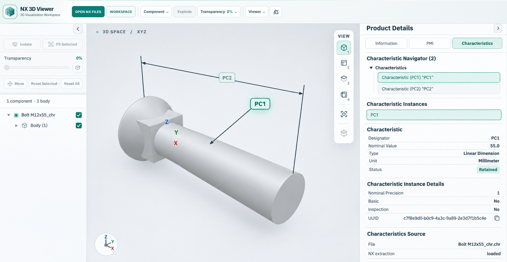
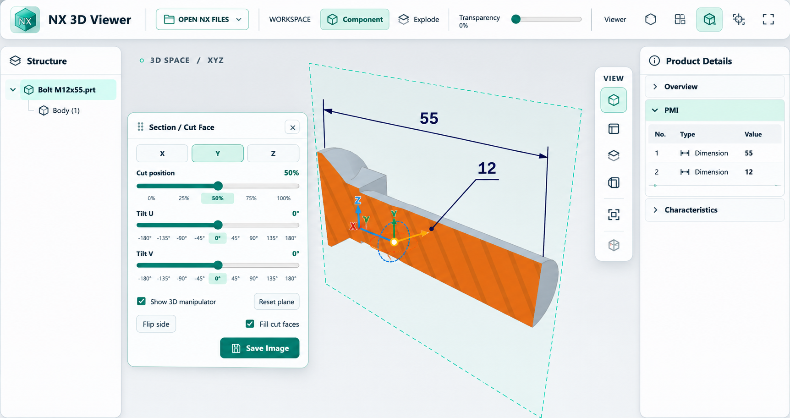

# NX 3D Viewer

A local 3D visualization application for Siemens NX parts and assemblies. View CAD geometry, inspect component information, measure surfaces, and explore PMI and NX Inspector Characteristics in a browser.

## Main features

- Open **NX PRT** and **JT** models, including supported assemblies and linked JT component folders.
- Manage files and folders in **Workspace**, with companion-file guidance for JT packages and PRT/CHR pairs.
- Browse the product structure; select, show/hide, isolate, move, explode, and color components.
- Rotate, pan, zoom, fit, and switch between 3D, front, top, and right views.
- Adjust component transparency and measure distances, angles, and cylindrical diameters. CAD-derived measurements are used when NX provides reliable geometry; STL-only measurements are approximate.
- Browse **PMI** annotations with dimension graphics, associated geometry, and available parameters.
- Browse **Characteristics** from a matching NX Inspector `.chr` file, including instances, parameters, and associated PMI highlighting.
- Use **Section / Cut Face** to inspect internal geometry along X, Y or Z, adjust the cut position and plane tilt, flip the retained side, and fill cut faces.
- Save the section view as a **PNG** with orange cut faces, gray original surfaces, visible applicable PMI and Characteristics, and a title block showing the original filename and section plane. Non-cut components are hidden in the export; the component arrangement is preserved when annotations are displayed.

## Screenshots

**Assembly visualization** — exploded assembly with colored components and selected-component information.


**PMI and Characteristics** — bolt model with its linked Characteristics and selected 3D annotation.



**Section / Cut Face** — interactive section view of a bolt with visible PMI dimensions, adjustable cut position and plane orientation. Use **Save Image** to export the section with applicable annotations and without the section dialog or manipulator.



*Illustrative application composites based on the provided 3D model captures; panel figures shown in the images are examples.*

## Requirements

- Windows with **Siemens NX 2506**, including a working `run_journal.exe` and the appropriate NX licenses.
- **Python 3.10+**.
- A modern browser with WebGL support.

The NX Inspector module/license is required for reading native Characteristics through NX Open. JT conversion depends on the formats supported by the installed NX environment.

## Getting started

1. Run **`Run.bat`** in the project folder.
2. Open **http://127.0.0.1:8888/** in your browser.
3. Select **OPEN NX FILES**, or use **WORKSPACE** to upload your model and open it there.
4. Use the **Structure** panel on the left, the 3D viewer in the center, and the **Information / PMI / Characteristics** tabs on the right.
5. Stop the server with **Ctrl+C** in its terminal window.

## File relationships

For a part with NX Inspector Characteristics, keep the files together in the same Workspace folder:

```text
Bolt M12x55.prt
Bolt M12x55_chr.chr
```

Open the **PRT** to view the geometry, PMI, and linked Characteristics. The viewer reads CHR data without editing the native file. The Workspace upload wizard can help select a missing companion file.

For externally linked JT assemblies, preserve the JT references and the related component folder structure when uploading.

## Notes

- The viewer uses STL meshes generated through Siemens NX. Its measurements and visual representations are not a substitute for certified CAD inspection or metrology.
- Exact PMI and Characteristics data availability depends on NX 2506, the model contents, and the installed NX capabilities.
- Native CHR editing and standalone STEP viewing are not supported.
