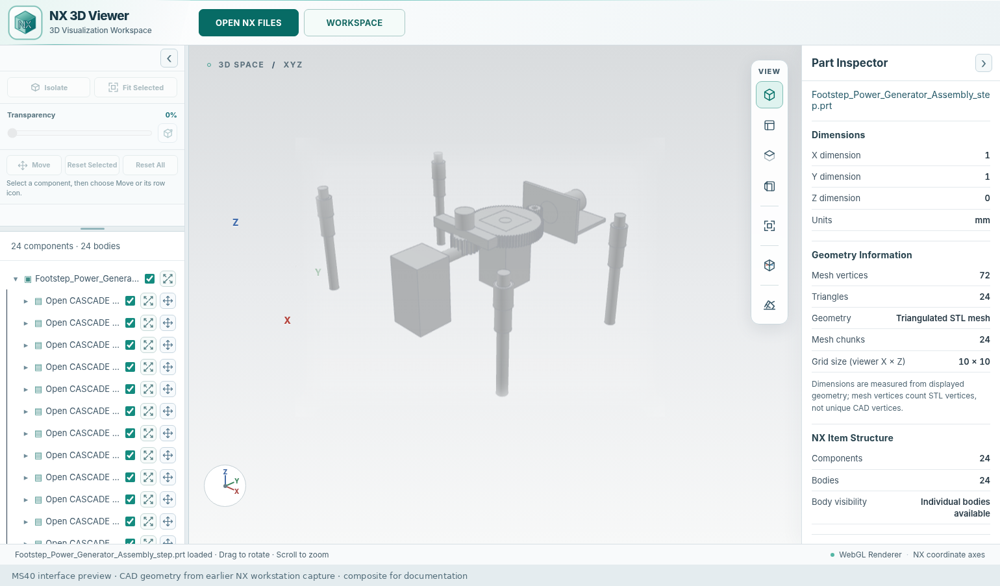

# NX 3D Viewer

A local browser-based 3D viewer for Siemens NX part geometry. It runs on your computer with a Python server and a WebGL browser interface, using **port 8888**.

## Features

- Open Siemens NX **`.prt`** files from the server computer and visualize their geometry.
- Render NX geometry as tessellated STL surfaces; original NX files are not changed.
- Use the light NX 3D Viewer header to open NX files, with compact icon-based camera controls inside the 3D workspace.
- Rotate, pan, zoom, and switch between isometric, front, top, and right views. Imported models are automatically centered and fitted in full, with a margin around their geometry.
- Work in an NX-style light gray 3D environment with a light silver-steel model, NX X/Y/Z axes and exactly three small XY, YZ, and XZ coordinate reference planes. The grid is hidden by default while the coordinate references remain visible.
- Browse the NX part and component hierarchy in a collapsible, resizable white left panel.
- Inspect model dimensions, geometry counts, part details, NX units, and available NX attributes in the white right Part Inspector panel.
- Expand/collapse components, select items, and show/hide individual bodies when separate body geometry is available.
- Use a local Python server and bundled frontend code, without external JavaScript packages or a cloud service.

## Requirements

- Windows with a working, licensed Siemens NX installation (NX 1855 is the target configuration) for opening `.prt` files.
- Python 3.10 or newer.
- A browser with WebGL support.

Actual `.prt` conversion requires NX Open and its `run_journal.exe` program. An NX installation may also need the proper assembly component files and licensing available on the same computer.

## Viewer screenshot



*Illustrative screenshot from an earlier dark-interface layout, with the reference grid visible. The current application uses a light theme, no grid by default, and floating camera icons.*

## Start

1. Open the project folder on your Windows computer.
2. Double-click **`Run.bat`**, or run `py -3 backend/server.py` in a terminal.
3. Open **http://127.0.0.1:8888/** in your browser.
4. Press **Ctrl+C** in the terminal to stop the server.

The server listens only on the local computer. Port **8888** is fixed.

## Open an NX file

1. Click **OPEN NX FILES** in the top toolbar.
2. Choose a `.prt` file using the file selection dialog on the **computer running the Python server**.
3. The viewer asks Siemens NX to open the part and create a temporary STL representation.
4. The current geometry and item structure are cleared, and a loading screen is shown while the new file is prepared.
5. When the file is loaded, use **Item Structure** at the left to browse the NX part, components, and bodies.

The empty viewer starts with a neutral coordinate-reference view without a grid. When a model loads, the camera automatically adjusts to show the entire model. If the operation is cancelled or fails, the workspace remains empty and an error or cancellation message is shown. Exported STL files are stored temporarily and removed when the server exits. No conversion overwrites or saves the original `.prt` file.

If NX cannot be found, set the `NX_RUN_JOURNAL` environment variable to the complete path of `run_journal.exe` and restart the server. For example, in PowerShell:

```powershell
$env:NX_RUN_JOURNAL = 'C:\Program Files\Siemens\NX1855\NXBIN\run_journal.exe'
py -3 backend/server.py
```

Adjust the path to your actual NX installation. The launcher also looks for NX using standard Siemens environment variables and common Windows installation folders.

## Viewer controls

The light header displays the NX 3D Viewer branding and **OPEN NX FILES** command, with room for future features. Camera controls are floating icon buttons at the upper-right corner of the 3D workspace; hover for a tooltip. The Item Structure panel remains on the left.

| Action | Control |
| --- | --- |
| Rotate | Left mouse drag |
| Pan | Right mouse drag, or Shift + left drag |
| Zoom | Mouse wheel |
| Fit | **Fit icon** in workspace, **F**, or double-click |
| Camera views | **Isometric / Front / Top / Right icons** in workspace, or keys **1–4** |

Use the **Fit icon** (or **F**) after rotating or zooming to show the entire model again. The WebGL display is Y-up: NX (X, Y, Z) is mapped to viewport (X, Z, −Y). Axis labels, the rotating axis compass, and the Part Inspector dimensions retain NX X/Y/Z meaning.

## Item Structure panel

- Click the arrow at the top of the panel to collapse or expand it.
- Drag the panel divider horizontally to resize the tree; the divider can also be adjusted with the left/right arrow keys.
- Click the disclosure arrows to browse nested NX components and bodies. Click an item name to select it in the tree.
- Use the checkboxes to show or hide whole components or individual bodies when separate NX body geometry is available.

The panel shows the hierarchy reported by NX Open. If NX can only export a combined STL, the model still displays, but individual visibility controls are disabled rather than presenting an inaccurate result.

## Part Inspector

The **Part Inspector** opens at the right side of the 3D workspace and displays information for the loaded NX file:

- **Dimensions:** X, Y, and Z measurements from the displayed STL geometry, in the NX part's units when reported by NX.
- **Geometry:** mesh-vertex and triangle counts, mesh chunks, and reference-grid size.
- **Structure:** numbers of NX components and bodies, and whether individual body visibility is supported.
- **File details:** `.prt` name, file location, size, and last modified time when accessible.
- **NX attributes:** user attributes returned by NX Open, when available.

Selecting a part, component, or body in the left **Item Structure** panel updates the **Selected Item** section. When body meshes are exported separately, the inspector also shows the selected item's mesh dimensions and triangle count. If only combined geometry is available, item-specific measurements are not provided. Click the arrow at the top of Part Inspector to collapse or expand the panel.

All dimensions and mesh statistics describe the tessellated visualization; they are not precise CAD feature or mass-property measurements. Attributes and units not reported by NX are not invented.

## Supported scope

The NX-to-browser workflow displays **tessellated surfaces**, not editable CAD solids or exact NX B-rep geometry. Both standalone parts and assembly occurrences are considered by the exporter, but a model that contains missing or unloaded component geometry will report an error rather than silently show incorrectly positioned components. The item hierarchy comes from NX Open; it is not inferred from a combined STL. Per-body visibility requires separate body exports. Model-tree selection does not yet highlight faces in the viewport.

The browser currently accepts up to **1,000,000 STL triangles** or **256 MB** of STL data. The **OPEN NX FILES** command currently accepts `.prt` files only. Siemens NX `.jt` and `.chr` files are not supported.
