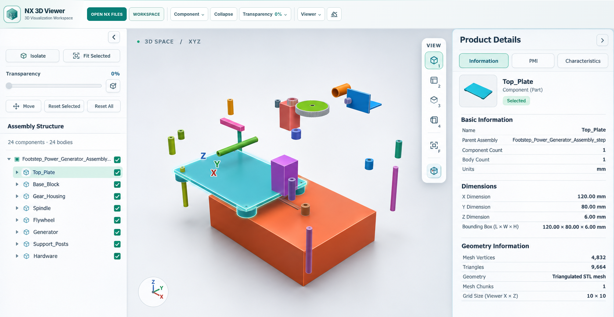

# NX 3D Viewer

A local and LAN-accessible 3D visualization application for Siemens NX parts and assemblies. View CAD geometry, inspect component information, measure surfaces, and explore PMI and NX Inspector Characteristics in a browser.

## Main features

- Open **NX PRT** and **JT** models, including supported assemblies and linked JT component folders.
- Upload, open and manage files and folders in **Workspace**, with companion-file guidance for JT packages and PRT/CHR pairs. Workspace is the single file entry point in local and LAN modes.
- Serve the viewer on a private LAN with automatic IPv4 selection; client computers only require a supported web browser.
- Browse the product structure; select, show/hide, isolate, move, explode, and color components.
- Rotate, pan, zoom, fit, and switch between 3D, front, top, and right views.
- Adjust component transparency and measure distances, angles, and cylindrical diameters. CAD-derived measurements are used when NX provides reliable geometry; STL-only measurements are approximate.
- Browse **PMI** annotations with dimension graphics, associated geometry, and available parameters.
- Browse **Characteristics** from a matching NX Inspector `.chr` file, including instances, parameters, and associated PMI highlighting.
- Use **Section / Cut Face** to inspect internal geometry along X, Y or Z, adjust the cut position and plane tilt, flip the retained side, and fill cut faces.
- Save the section view as a **PNG** with orange cut faces, gray original surfaces, visible applicable PMI and Characteristics, and a title block showing the original filename and section plane. Non-cut components are hidden in the export; the component arrangement is preserved when annotations are displayed.

## Screenshots

**Assembly visualization** — exploded assembly with colored components and selected-component information.



**PMI and Characteristics** — bolt model with its linked Characteristics and selected 3D annotation.


**Section / Cut Face** — interactive section view of a bolt with visible PMI dimensions, adjustable cut position and plane orientation. Use **Save Image** to export the section with applicable annotations and without the section dialog or manipulator.


*Illustrative application composites from earlier milestones; panel figures shown in the images are examples. The former OPEN NX FILES toolbar button shown in earlier images has been removed; use WORKSPACE instead.*

## Requirements

- **Host/server:** Windows with **Siemens NX 2506**, including a working `run_journal.exe`, appropriate NX licenses and **Python 3.10+**.
- **Client:** a modern browser with WebGL support and access to the host on TCP port 8888. No Siemens NX or Python installation is required on client computers.

The NX Inspector module/license is required for reading native Characteristics through NX Open. JT conversion depends on the formats supported by the installed NX environment.

## Getting started

Run the following commands from the project root in Windows PowerShell.

### Local development

```powershell
py -3 backend/server.py
```

Open **http://127.0.0.1:8888/**. This mode listens only on localhost. No firewall configuration is required. Refresh the browser after frontend changes and stop/restart the Python server after backend changes.

### LAN server deployment

On the server, open PowerShell as Administrator and configure Windows Firewall once:

```powershell
.\Run.bat --firewall
```

This creates a persistent inbound TCP 8888 rule for Private/Domain networks, restricted to the local subnet. A matching rule is reused; conflicting rules are reported without being overwritten. Repeat setup only when deploying to another host or when the rule must be restored or changed. Company firewall policy may require IT approval or a more restrictive client address range.

Start the server in a normal PowerShell window (or double-click `Run.bat`):

```powershell
.\Run.bat
```

The launcher detects a private LAN IPv4 address automatically and displays the website URL. On another computer on the permitted network, open the displayed URL, for example `http://172.16.2.88:8888/`. Use the actual address printed on your server, not this example. Automatic detection does not require Internet access. A static address or DHCP reservation is recommended for a stable server URL.

### Run commands

| Purpose | PowerShell command |
| --- | --- |
| Local development | `py -3 backend/server.py` |
| Start LAN server (automatic IP) | `.\Run.bat` |
| One-time firewall setup (Administrator) | `.\Run.bat --firewall` |
| Local-only startup | `.\Run.bat --local` |
| Manual IP override (if adapter selection is ambiguous) | `.\Run.bat --lan 172.16.2.88` |
| Direct Python LAN development (automatic IP) | `py -3 backend/server.py --lan` |
| Stop server | `Ctrl+C` in the running server terminal |

### Open a CAD model

1. Open the viewer in your browser and select **WORKSPACE** in the toolbar.
2. Use **Upload** to transfer CAD files or folders from your computer to the host's Workspace. Preserve related files using the companion-file wizards when needed.
3. Select a PRT or JT model in Workspace and open it. NX conversion runs on the host/server, not on the client.
4. Use the **Structure** panel on the left, the 3D viewer in the center, and the **Information / PMI / Characteristics** tabs on the right.

### Update and restart the server

1. Complete and verify the feature on the development PC.
2. Notify users of the maintenance window. Stop the server with **Ctrl+C**, wait for active requests and shutdown to finish, and confirm `Y` if Windows asks whether to terminate the batch job.
3. Deploy the updated source files to the server project folder. Preserve the existing `uploads/` folder and its CAD data.
4. Run `.\Run.bat` again. No separate restart script or repeated firewall setup is needed.
5. Reopen the server URL and refresh the browser (`Ctrl+F5` if necessary). Clients may need to reopen models because converted geometry is temporary.

### Network security and future PLM integration

LAN mode is intended only for a trusted internal network. There is currently no login, per-user authorization or HTTPS. Reachable clients share the Workspace, including upload, replacement and deletion capabilities. Do not expose port 8888 to the public Internet. Future PLM integration must enforce permissions on the server for model access, uploads, modifications and deletion; hiding UI controls is not sufficient.

## File relationships

For a part with NX Inspector Characteristics, keep the files together in the same Workspace folder:

```text
Bolt M12x55.prt
Bolt M12x55_chr.chr
```

Open the **PRT** to view the geometry, PMI, and linked Characteristics. The viewer reads CHR data without editing the native file. The Workspace upload wizard can help select a missing companion file.

For externally linked JT assemblies, preserve the JT references and the related component folder structure when uploading.

## Notes

- The viewer uses STL meshes generated through Siemens NX. Its measurements and visual representations are not a substitute for certified CAD inspection or metrology.
- Exact PMI and Characteristics data availability depends on NX 2506, the model contents, and the installed NX capabilities.
- Native CHR editing and standalone STEP viewing are not supported.
